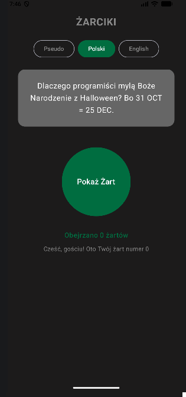
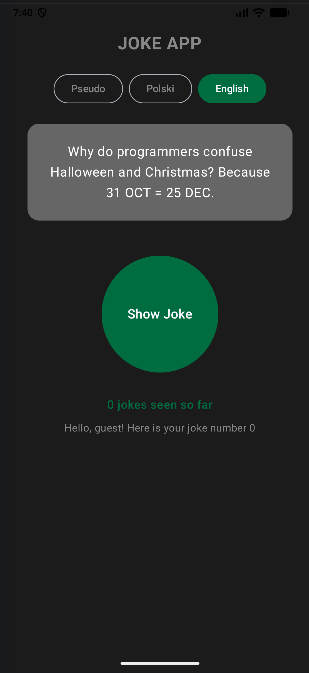
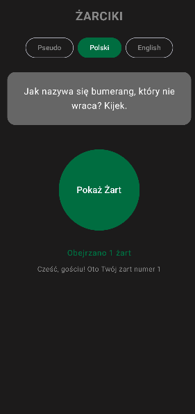
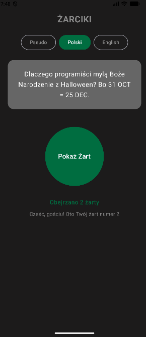
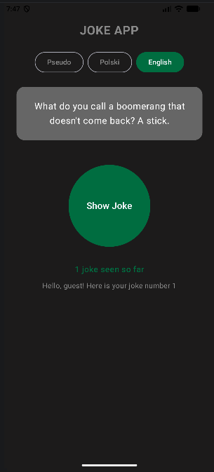
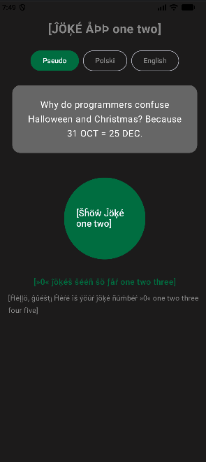

# Sprawozdanie - Laboratorium 3: Tłumaczenie aplikacji

**Przedmiot:** Programowanie Systemów Mobilnych
**Temat:** Mechanizmy tłumaczeń, liczba mnoga (plurals) i pseudojęzyki.

## 1. Zrzuty ekranu podstawowej wersji aplikacji

Główny widok aplikacji w obu obsługiwanych językach (polskim i angielskim).

| Wersja polska | Wersja angielska | 
| :---: | :---: | 
|  |  | 

## 2. Obsługa liczby mnogiej (Plurals)

Język polski wymaga obsługi wielu form gramatycznych w zależności od liczby. Poniżej zrzuty ekranu potwierdzające poprawne działanie mechanizmu.

| Forma "żartów" / "żart" | Forma "żarty" | Wersja angielska (Plurals) |
| :---: | :---: | :---: |
|  |  |  | 

## 3. Test gotowości na tłumaczenie (Pseudojęzyk en-XA)

| Aplikacja w pseudojęzyku | 
| :---: | 
|  | 

**Wnioski i potrzebne poprawki po teście (en-XA):**
1. **Pasek wyboru języka:** Teksty przycisków ("Polski", "English") rozszerzają się. Może to powodować nachodzenie na siebie elementów lub łamanie wiersza (wymagany układ elastyczny np. `FlowRow`).
2. **Główny przycisk:** Wydłużona etykieta ledwo mieści się wewnątrz koła. Może być konieczne zmniejszenie czcionki lub powiększenie przycisku.
3. **Brak "krzaczków" w żarcie:** Generator pseudojęzyka w Androidzie domyślnie ignoruje zawartość elementów `<string-array>`, co jest normalnym zachowaniem systemu (tłumaczy tylko pojedyncze `<string>`).

## 4. Odpowiedzi na pytania teoretyczne

### Dlaczego warunek sprawdzający liczbę pojedynczą (if n == 1) jest w języku polskim niewystarczający?
Polski język posiada aż 4 kategorie gramatyczne dla liczb (one, few, many, other) według standardu CLDR. Zwykły `if` nie poradzi sobie płynnie z tym, że np. dla liczby 2 używamy "żarty", dla 5 "żartów", a dla 22 ponownie "żarty". Trzeba użyć zasobu `<plurals>`.

### Który zestaw zasobów powinien być domyślny i dlaczego?
Domyślny (w folderze `values` bez kwalifikatorów) powinien być **język angielski**. Jest to tzw. zestaw awaryjny (fallback) – jeśli użytkownik używa np. języka japońskiego, którego nie przetłumaczyliśmy, aplikacja załaduje domyślne zasoby. Angielski jest najbardziej uniwersalny.

### Wybór wariantu zmiany języka z poziomu aplikacji
Wybrano wariant oparty na bibliotece zgodności (`AppCompatDelegate`). Zapewnia on wsteczną kompatybilność ze starszymi wersjami Androida (poniżej API 33). Aby wariant ten zadziałał, wymagana była zmiana klasy bazowej na `AppCompatActivity` oraz użycie motywu `Theme.AppCompat`.